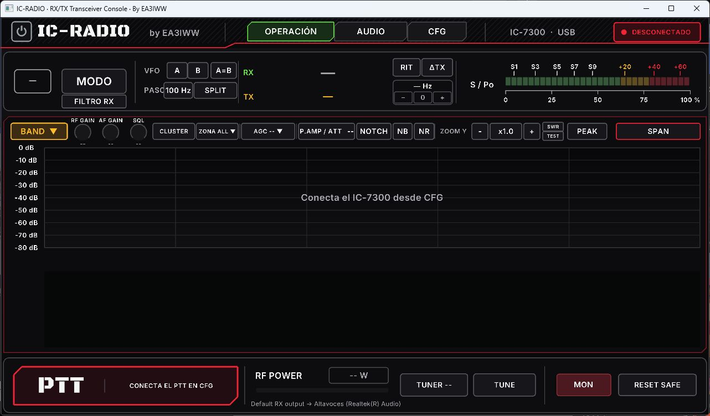
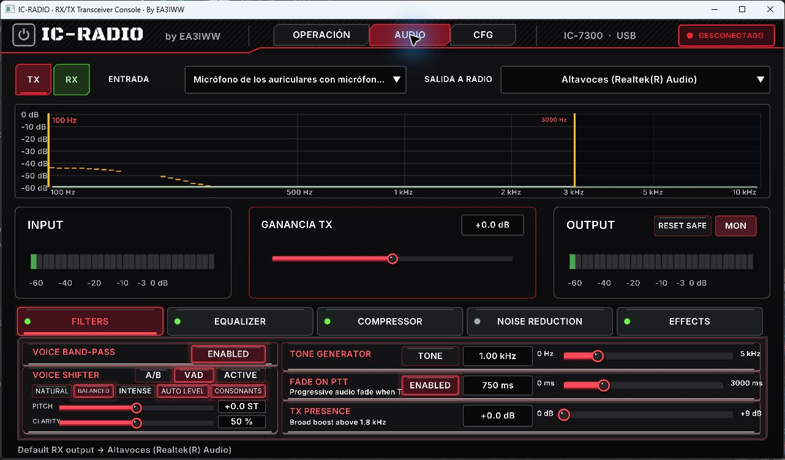
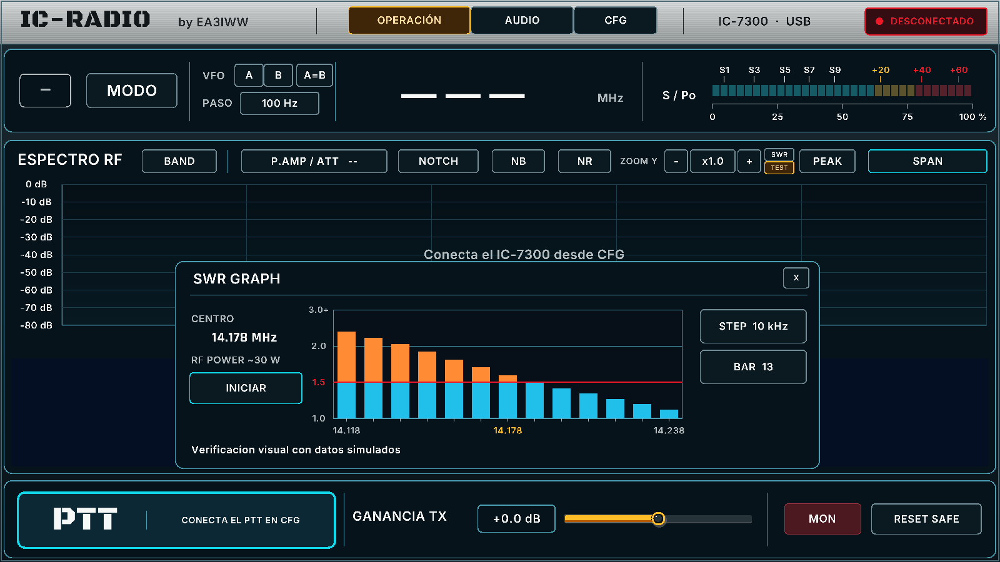
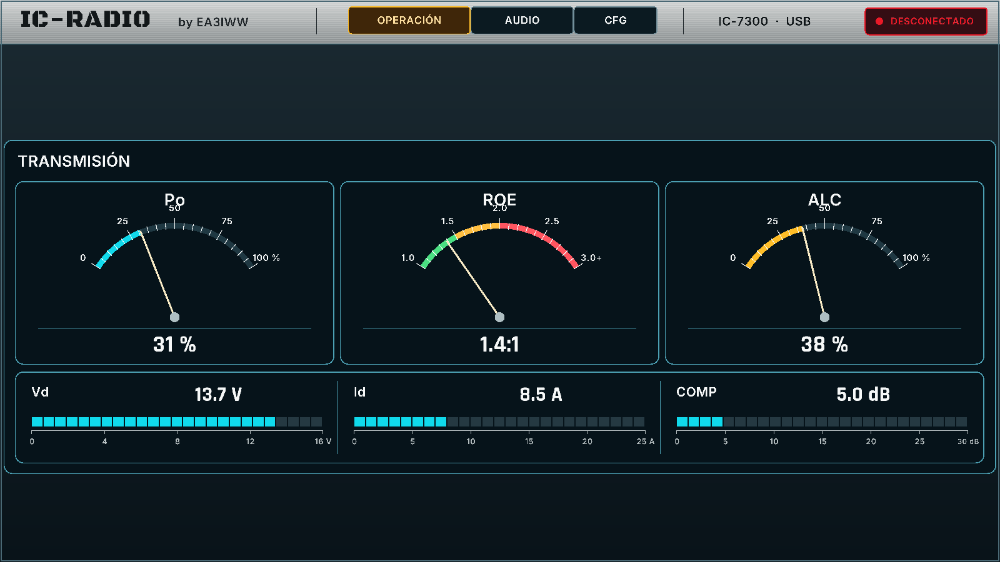

# IC-RADIO

IC-RADIO is a Windows console dedicated to local and remote control of the Icom IC-7300 and IC-7300MK2. It combines USB CI-V radio control, real-time RX/TX audio processing, and PTT over RTS or DTR. Local mode connects directly over USB. Remote mode uses the included server on the same PC or over the local network.





## Features

- Independent RX and TX audio routes with drop-down device selectors.
- Logarithmic spectrum, input/output meters, and draggable filter markers.
- Eleven-band graphic equalizer up to 10 kHz, with reset and bypass.
- Adjustable high-pass and low-pass voice filters.
- RX notch filter with draggable frequency, width, and depth controls.
- Portable WDSP 2.11 RX engine with NR2/NNR, automatic notch, impulse noise
  blanker, Standard/Premium models, and automatic fallback to the classic DSP.
- Sonic Sequencer for configurable PTT opening and closing cues, including
  tones, pauses, sweeps, Morse callsigns, three waveforms, and live RX preview.
- SSB voice emphasis and 50/75 µs FM de-emphasis.
- TX compressor, configurable noise reduction, output gain, and presence.
- TX echo with delay, feedback, mix, tone profiles, and quick presets.
- Formant-preserving voice shifter from -4 to +4 semitones.
- Natural, Balanced, and Intense voice-shifter modes, automatic level,
  consonant protection, voice activity bypass, clarity, and A/B monitoring.
- `MON` output for listening to processed TX audio through the RX headphones.
- Monitor clock-drift compensation and risky-route feedback detection.
- Progressive TX saturation protection with manual safety reset.
- Automatic 100% volume and unmute preparation for the radio USB endpoint.
- PTT over RTS or DTR with Hold and Lock modes, configurable shortcut, and
  emergency return to RX with Escape.
- Persistent independent RX/TX settings and three named global presets.
- Self-contained source tree: the DSP core and all Go dependencies are
  included locally under `vendor`.

## Compatibility

IC-RADIO targets the **Icom IC-7300** and **Icom IC-7300MK2**. Connect the radio to the Windows PC over USB and select its CI-V serial port. For audio and PTT, select the radio's USB recording and playback devices, set USB audio as the modulation source, and match the radio's USB SEND setting to RTS or DTR in IC-RADIO.

Use the CI-V address shown in your radio's settings. The IC-7300 factory address is `94h`. For the IC-7300MK2, consult the [Icom CI-V reference guide](https://www.icomjapan.com/support/manual/4486/) and enter the address configured on your radio.


## Windows installation

Download the Windows x64 ZIP from [GitHub Releases](https://github.com/LuislopezMartinez/IC-RADIO/releases/latest), extract it, and
run `ic-radio.exe`. Windows may display a warning because the executable is not
digitally signed.

Settings are stored in `%AppData%\IC-MIC\settings.json`.

> Headphones are recommended when using `MON`; loudspeakers can create acoustic
> feedback through the microphone.

## Building locally

Requirements: Go 1.22 or later, CGO, and a Windows-compatible C compiler. No
external IC-DSP checkout or Go module download is required.

```powershell
.\build-radio-windows.ps1
```

The portable release keeps `runtime/wdsp.dll` and `runtime/libfftw3-3.dll`
beside the application directory. To reproduce those native binaries from the
pinned official WDSP 2.11 source, install the MSYS2 UCRT64 GCC and FFTW
packages, then run:

```powershell
.\build-wdsp-windows.ps1
```

WDSP and FFTW are GPL components. See `THIRD_PARTY_NOTICES.md` and the license
copies under `THIRD_PARTY_LICENSES` before redistributing IC-RADIO.

## Local USB control

Open **CFG** to select the radio's USB COM port and the RTS or DTR line used for PTT, then connect. On the radio, set **CI-V USB Port** to **Unlink from [REMOTE]**, **CI-V USB Baud Rate** to **115200**, and enable **CI-V Transceive** for immediate dial updates. Match the CI-V address in CFG to the address configured on your radio. Open the radio's **SCOPE** if sweep data does not appear. Close other applications that have opened the same COM port. For a PTT-only setup, turn off **CI-V USB** in CFG.

**Operación** shows the radio frequency, operating mode, filter, RX/TX state, and RF spectrum with a waterfall. Click a digit and scroll over the frequency readout to tune in that digit’s steps, with lower places rounded in the direction of the scroll. Right-click the readout for direct Hz or MHz entry and press Enter. Click the trace or waterfall to tune to a signal. Enable **PEAK** to display a per-bin peak trace that drops gradually after each pulse. Click the span control to cycle spans in Center mode. The spectrum displays the radio's **REF** level in dB when a recent CI-V reading is available. Click the meter to select a reading on the PC. In **S / Po** mode, the reading follows the radio's receive or transmit state. The meter selection on the radio's physical screen is not synchronized.

**Audio** selects the existing TX and RX processing profiles. **CFG** also contains PTT settings and the Sonic Sequencer.

In **Operación**, use **RF POWER** to adjust the radio's output setting over CI-V. **TUNER** toggles the internal tuner and **TUNE** starts a tuning cycle. In **CFG**, **VFO INICIAL** lets you choose A, B, or manual selection when connecting.

Use **RF GAIN**, **AF GAIN**, **SQL**, and **AGC** in Operación to adjust the receiver over CI-V. The **A=B** control asks for confirmation before sending the command to the radio. Band edge indicators mark the selected band on the RF display. Open **P.AMP / ATT** to select the preamp, attenuator, or off.

### DX Cluster

In **Operación**, turn on **CLUSTER** to load recent spots from DXFun for the
active band. Public spots refresh every minute. Right-click **CLUSTER** to
optionally add a live Telnet connection with your DXFun callsign.
**ZONA** filters the spotted station's DXCC region. Only recent spots within
the active band and visible sweep are shown. Spot labels descend from 0 to 10
minutes of age on the waterfall. Click a callsign or flag and choose **Tune** or **Open QRZ**. Click a grouped count to select a station first.

### Separate RX and TX tuning

**SPLIT** uses separate receive and transmit VFOs. **RIT** applies the offset to receive, and **ΔTX** applies it to transmit. Click the offset value for direct entry, use the wheel or the − and + controls to adjust it, and press **0** to clear it. The spectrum shows RX and TX markers when the radio reports both frequencies.

Open **FILTRO RX** to select FIL1, FIL2, or FIL3 and adjust the IF bandwidth when the radio reports it for the current mode. In SSB, the outer passband edge can also be dragged on the spectrum when available.


### SWR measurements

Open **TEST** in the spectrum controls to see the SWR graph and select the frequency step and number of points. Center the radio on the frequency you want to measure. The sweep requires the radio in receive, with SPLIT and ΔTX off, USB or LSB with USB modulation, and **USB Audio CODEC** as the Audio TX output. The sweep transmits a test tone. Use a suitable antenna or dummy load and check that the sweep frequencies are clear and allowed before pressing **INICIAR**. Press **DETENER** or Escape to cancel.

Completed sweeps are saved per band. Use **SWR** to overlay the saved sweep on the RF spectrum.




### TX telemetry

During transmission, Operación displays output power, SWR, ALC, supply voltage and current, and compressor level when reported by the radio. The TX indicators are smoothed for readability. The Po needle, bar and numeric readout rise quickly and fall gradually between voice peaks. The numeric SWR readout shows the latest valid radio measurement.



## Remote control via the local server

The Windows ZIP includes `ic-radio-server.exe`. Run it on the Windows PC connected to the IC-7300 or IC-7300MK2, select the USB COM port and CI-V address, and set an access password. The default PTT line is RTS. If the radio uses DTR, start the server with `-ptt-line DTR`. Run `ic-radio-server.exe -h` for the available options. If multiple matching USB audio devices are present, start the server interactively and choose the radio RX input and TX output. The server remembers the selected device IDs. The remote client displays the server-side device names when available.

Open `ic-radio.exe`, select **MODO REMOTO** in **CFG**, and enter the server port (default `7300`) and password. Use `127.0.0.1` on the server PC or the **LAN address** shown by the server on another PC. If Windows Firewall prompts for access, allow the server on private networks. Use remote mode on a trusted LAN because the connection uses HTTP. Keep the server port off the public internet. The server handles CI-V and, when the radio's USB audio devices are available, RX audio, microphone TX and PTT, and SWR sweeps. Close other applications using the radio's COM port before starting the server.


## PTT safety

IC-RADIO clears RTS and DTR when opening and closing the serial port. Escape
forces an immediate return to RX, and Hold mode returns to RX automatically if
the application loses focus.

## Credits

Created by EA3IWW. The embedded DSP core originates from IC-DSP. The interface
includes Inter and Black Ops One under the SIL Open Font License 1.1.
