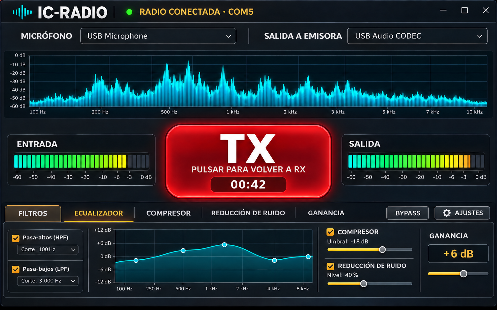

# IC-RADIO

Consola de audio RX/TX para transceptores con interfaz USB, procesamiento DSP
en tiempo real y control PTT mediante RTS o DTR. Permite utilizar un micrófono
USB externo, procesar la voz y enviarla a la entrada de audio USB de la radio.



## Funciones

- Rutas independientes de recepción y transmisión.
- Selección desplegable de dispositivos de grabación y reproducción.
- Ecualizador gráfico de 11 bandas, hasta 10 kHz, con restablecimiento y bypass.
- Filtros de corte inferior y superior ajustables sobre el espectro.
- Énfasis de voz SSB y deénfasis FM de 50/75 µs.
- Notch RX gráfico con frecuencia, anchura y profundidad ajustables.
- Compresor TX en pasos predefinidos.
- Eco TX con retardo, realimentación, mezcla, tono y perfiles rápidos.
- Reducción de ruido regulable con integración lenta, media o rápida.
- Ganancia independiente para RX y TX.
- Monitor `MON` para escuchar la señal TX procesada por los auriculares RX.
- Espectro y medidores de entrada y salida.
- PTT por RTS o DTR con modos mantener y bloqueo.
- Atajo PTT configurable y retorno de emergencia a RX mediante Escape.
- Persistencia independiente de todos los parámetros RX y TX.

## Compatibilidad

IC-RADIO puede utilizarse con transceptores que expongan en el ordenador:

1. Una entrada de grabación USB para recibir el audio de la radio.
2. Una salida de reproducción USB para enviar audio hacia la radio.
3. Un puerto serie capaz de controlar PTT mediante RTS o DTR.

La denominación de dispositivos y los menús cambian según el fabricante. En
la radio debe seleccionarse el audio USB como fuente de modulación y asignarse
PTT/SEND a la misma línea RTS o DTR elegida en IC-RADIO. Icom IC-7300 es uno de
los equipos compatibles, pero no es un requisito del programa.

## Instalación en Windows

Descarga `IC-RADIO-Windows-x64.zip` desde la sección **Releases**, extrae su
contenido y ejecuta `ic-radio.exe`. Windows puede mostrar una advertencia al
tratarse de un ejecutable sin firma digital.

Las preferencias se guardan en `%AppData%\IC-MIC\settings.json`.

> Para utilizar `MON` se recomiendan auriculares; los altavoces pueden producir
> realimentación acústica con el micrófono.

## Compilación sin dependencias externas

Requisitos: Go 1.22 o posterior, CGO y un compilador C compatible con Windows.
El repositorio incluye localmente el núcleo DSP y todas las dependencias Go en
el directorio `vendor`; no necesita el proyecto IC-DSP ni descargar módulos.

```powershell
go test -mod=vendor -tags noaudio ./...
go build -mod=vendor -tags noaudio -trimpath -ldflags '-H=windowsgui' -o ic-radio.exe ./cmd/ic-mic
```

## Seguridad PTT

IC-RADIO desactiva RTS y DTR al abrir y cerrar el puerto. Escape fuerza el
retorno inmediato a RX y el modo mantener vuelve automáticamente a recepción
si la aplicación pierde el foco.

## Créditos

El procesamiento de audio procede del núcleo de IC-DSP, incorporado en este
repositorio. La interfaz incluye Inter y Black Ops One bajo SIL Open Font
License 1.1.
